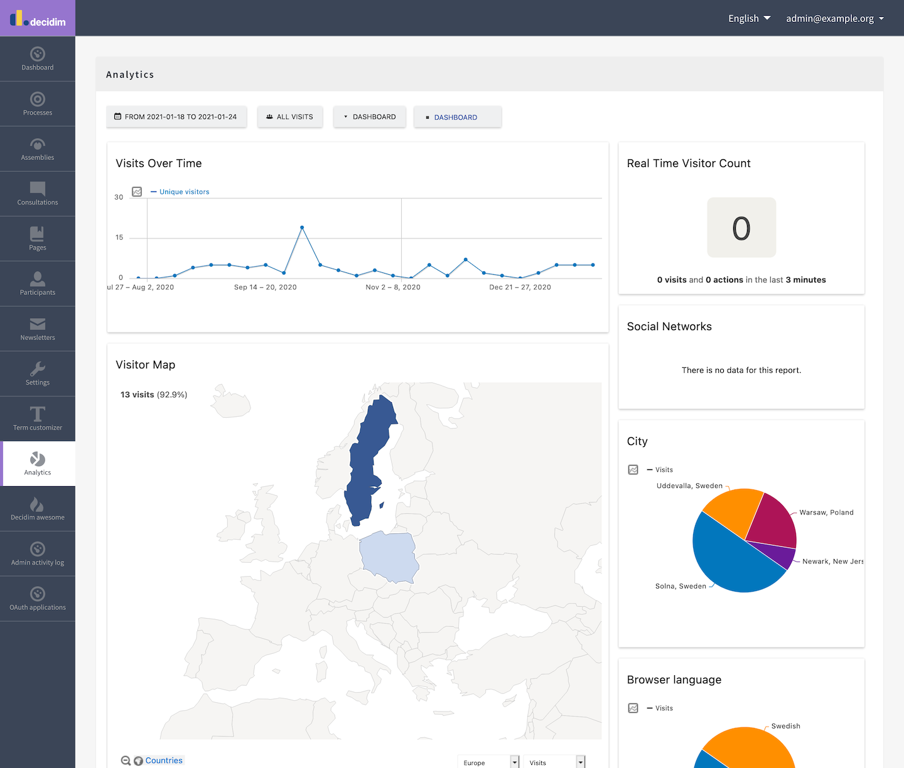

# Decidim::Analytics

A module adding an Analytics tab in the admin panel to embed a Matomo analytics dashboard.

Compatible with **Decidim 0.30.1**.



## Usage

This module doesn't have any settings panel as it doesn't store anything in the database. It will pick the data it needs from Rails credentials or secrets:

### Using Rails Credentials (Recommended for Decidim 0.30.1)

```bash
rails credentials:edit
```

```yaml
matomo:
    enabled: true # The tab will only be visible if enabled = true
    server_address: https://matomo.example.org # The URL of your Matomo instance
    site_id: 1 # The Matomo site ID of the Decidim platform
    token_auth: 6a710da82ecb933866507c14bdb99351 # A Matomo authentication token
```

### Using Rails Secrets (Legacy)

```yaml
matomo:
    enabled: true # The tab will only be visible if enabled = true
    server_address: https://matomo.example.org # The URL of your Matomo instance
    site_id: 1 # The Matomo site ID of the Decidim platform
    token_auth: 6a710da82ecb933866507c14bdb99351 # A Matomo authentication token
```

Follow [these instructions](https://matomo.org/docs/embed-matomo-reports/#embed-piwik-widgets-on-a-password-protected-or-private-page) to get `token_auth` from Matomo.

The dashboard that will be shown on page load uses the default layout you set for all new dashboards. You can create several other dashboards for the user and switch between them from Decidim.

## Requirements

- Ruby >= 3.1
- Decidim ~> 0.30.1

## Installation

Add this line to your application's Gemfile:

```ruby
gem "decidim-analytics", git: "https://github.com/digidemlab/decidim-module-analytics"
```

And then execute:

```bash
bundle install
```

### Setting up Matomo Tracking

After installing the gem, you need to enable Matomo tracking on your site by adding the tracking partial to your layout.

Create the file `app/views/layouts/decidim/_head_extra.html.erb` in your Decidim application with:

```erb
<%= render partial: "layouts/decidim/matomo" %>
```

This will automatically include the Matomo tracking code when the module is properly configured.

### Configuration with Environment Variables

For production environments, we recommend using environment variables with credentials:

```yaml
matomo:
    enabled: <%= !ENV["MATOMO_SITE_ID"].blank? %>
    server_address: <%= ENV["MATOMO_SERVER_ADDRESS"] %>
    site_id: <%= ENV["MATOMO_SITE_ID"] %>
    token_auth: <%= ENV["MATOMO_TOKEN_AUTH"] %>
```

## Contributing

Create an issue or a PR if you want to suggest an improvement. Keep in mind I'd like to keep this module lightweight and simple to maintain.

## License

This module is distributed under the GNU AFFERO GENERAL PUBLIC LICENSE.
